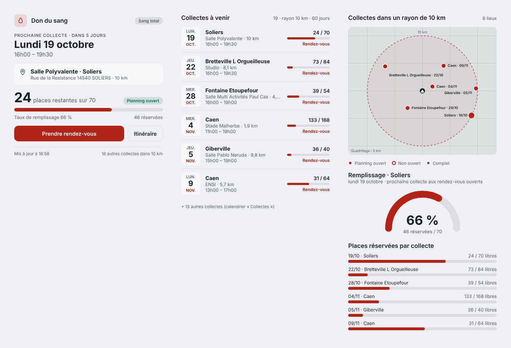
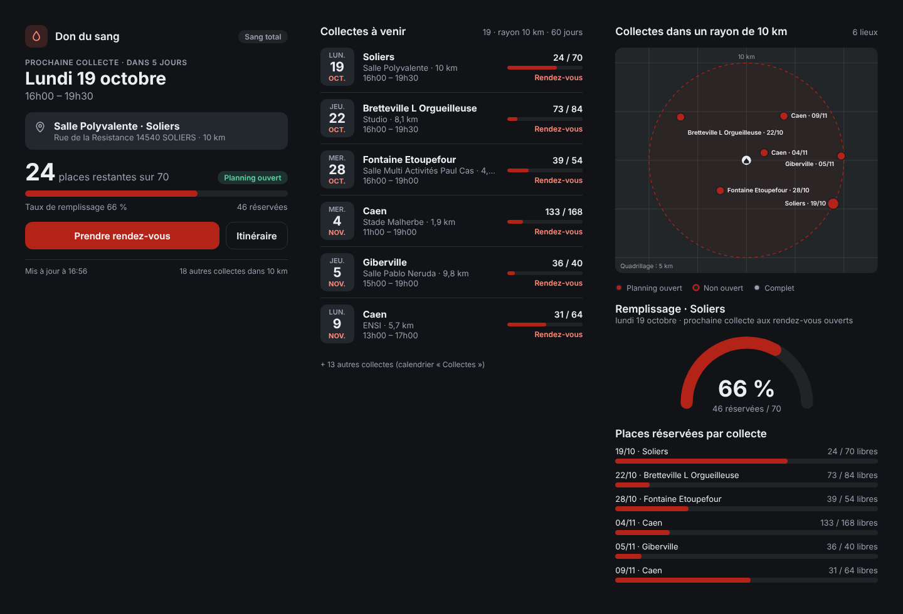

# EFS – Carte des collectes de don du sang

Carte Lovelace pour Home Assistant qui présente les collectes de l’Établissement français du sang remontées par l’intégration [HomeAssistant_DonduSang](https://github.com/LoloPicolo/HomeAssistant_DonduSang) : prochaine collecte, agenda des semaines à venir, plan des lieux et remplissage des créneaux.



## Prérequis

- Home Assistant 2024.11 ou plus récent.
- L’intégration **HomeAssistant_DonduSang en version 1.1.0 ou plus**, installée et configurée. La carte lit ses entités (`sensor.efs_prochaine_collecte`, `sensor.efs_collectes_a_venir`) ; la vue `carte` utilise les coordonnées et l’attribut `centre` apparus en 1.1.0.

## Installation

### Via HACS (recommandé)

1. HACS → ⋮ → **Dépôts personnalisés**.
2. URL : `https://github.com/LoloPicolo/HomeAssistant_DonduSang_Card`, catégorie **Tableau de bord** (*Dashboard*), puis **Ajouter**.
3. Rechercher « EFS – Carte des collectes de don du sang » dans HACS, **Télécharger**.
4. HACS déclare lui-même la ressource du tableau de bord. Rechargez la page du navigateur (Ctrl + Maj + R).
   Dans l’application mobile : Paramètres → Application compagnon → Dépannage (ou Débogage) → **Réinitialiser le cache du frontend**, puis fermez complètement l’application et rouvrez-la.

### Manuelle

1. Copier `dist/efs-collectes-card.js` dans `/config/www/efs-collectes-card.js`.
2. Paramètres → Tableaux de bord → ⋮ → **Ressources** → **Ajouter une ressource** : URL `/local/efs-collectes-card.js?v=1.0.0`, type **Module JavaScript**.
3. Recharger la page (et vider le cache de l’application mobile). À chaque mise à jour manuelle, incrémenter le `?v=` pour forcer le rechargement.

## Utilisation

La carte apparaît dans le sélecteur de cartes sous « EFS – Collectes de don du sang ». En YAML :

```yaml
type: custom:efs-collectes-card
vue: synthese
```

| Option | Défaut | Description |
|---|---|---|
| `vue` | `complet` | `synthese`, `agenda`, `carte`, ou `complet` (les trois empilées) |
| `entity` | `sensor.efs_prochaine_collecte` | Capteur de la prochaine collecte |
| `agenda_entity` | `sensor.efs_collectes_a_venir` | Capteur des collectes à venir |
| `max` | `6` | Nombre de lignes de l’agenda |
| `couleur` | `#B42318` | Couleur d’accent (hexadécimal) |

### Les trois vues

- **`synthese`** – date et créneaux de la prochaine collecte, lieu et distance, places restantes avec barre de remplissage et statut (*Planning ouvert*, *Planning non ouvert*, *Complet*), boutons **Prendre rendez-vous** et **Itinéraire** (OpenStreetMap).
- **`agenda`** – collectes à venir avec, pour chacune, les places restantes et un lien de rendez-vous, ou le statut si le planning n’est pas ouvert. Une collecte au planning fermé n’est jamais affichée comme « 0 place ».
- **`carte`** – plan schématique à l’échelle des lieux situés dans le rayon de recherche (sans fond de carte externe), jauge de remplissage de la prochaine collecte ouverte et places réservées par collecte.

### Plusieurs instances

Si l’intégration est configurée deux fois (domicile et travail, par exemple), les entités de la seconde instance portent le suffixe `_2` :

```yaml
type: custom:efs-collectes-card
vue: agenda
entity: sensor.efs_prochaine_collecte_2
agenda_entity: sensor.efs_collectes_a_venir_2
```

### Exemple de tableau de bord

```yaml
type: vertical-stack
cards:
  - type: custom:efs-collectes-card
    vue: synthese
  - type: custom:efs-collectes-card
    vue: agenda
    max: 5
  - type: custom:efs-collectes-card
    vue: carte
```



## Comportement

- La carte suit le thème de Home Assistant (clair ou sombre) et ne charge aucune ressource externe ; les seuls liens sortants mènent au site de l’EFS (rendez-vous) et à OpenStreetMap (itinéraire, lieux).
- Elle se redessine uniquement quand l’une des deux entités change, ce qui la garde légère même sur une tablette murale.
- Les liens de rendez-vous fournis sans `https://` par l’API de l’EFS sont complétés ; tout autre schéma est ignoré.

## Dépannage

| Symptôme | Cause et solution |
|---|---|
| « Custom element doesn’t exist: efs-collectes-card » | La ressource n’est pas chargée, presque toujours à cause du cache. Navigateur : Ctrl + Maj + R. Application mobile : réinitialiser le cache du frontend **et** forcer l’arrêt de l’application. |
| « Entités introuvables » | L’intégration n’est pas installée, ou les entités ont été renommées : renseigner `entity` et `agenda_entity`. |
| « Carte indisponible : mettez l’intégration à jour » | L’intégration est antérieure à la 1.1.0 ; la mettre à jour via HACS puis redémarrer Home Assistant. |
| Deux versions de la carte coexistent | L’intégration 1.1.0 embarquait elle aussi la carte. Mettre l’intégration en 1.2.0 ou plus, qui ne l’embarque plus, et supprimer toute ressource pointant vers `/efs_dondesang/efs-collectes-card.js`. |

## Licence

Code fourni tel quel, pour un usage personnel. Données : API Carto v3 de l’Établissement français du sang ; cette carte n’est pas affiliée à l’EFS.
